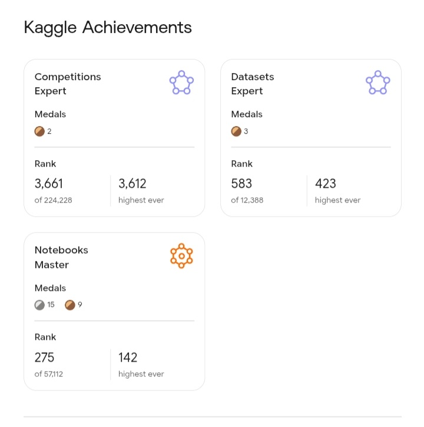

 

---

<h2 align="center">👋 ABOUT ME</h2>

I explore and develop intelligent systems using **Machine Learning, Deep Learning, Computer Vision, and Computational Biology**. My work spans scientific and real-world problems, from medical imaging and molecular modelling to multimodal learning, agricultural computer vision, and predictive modelling.

I enjoy experimenting with novel architectures, building robust models, competing in data science challenges, and turning research ideas into practical solutions.

> 💡 Always open to collaborating on challenging ML problems, research experiments, and open-source projects.

---

<h2 align="center">🏆 KAGGLE ACHIEVEMENTS & RECOGNITION</h2>

---

<h2 align="center">🛠️ TECHNOLOGIES & TOOLS</h2>

<h3 align="center">💻 PROGRAMMING LANGUAGES</h3>

<h3 align="center">🧠 MACHINE LEARNING & DEEP LEARNING</h3>

<h3 align="center">📊 DATA SCIENCE & VISUALIZATION</h3>

<h3 align="center">🧬 COMPUTATIONAL BIOLOGY & CHEMOINFORMATICS</h3>

<h3 align="center">🚀 DEVELOPMENT & DEPLOYMENT</h3>

<h3 align="center">☁️ PLATFORMS & ENVIRONMENTS</h3>

---

<h2 align="center">🐍 GITHUB CONTRIBUTION ACTIVITY</h2>

---

<h2 align="center">🤝 LET'S CONNECT</h2>

I'm always interested in collaborating on challenging machine learning problems, research experiments, open-source projects, and innovative AI applications.

&nbsp;&nbsp;&nbsp;

&nbsp;&nbsp;&nbsp;

<h3 align="center">Building Intelligent Systems. Exploring New Frontiers. Advancing AI Through Experimentation.</h3>

